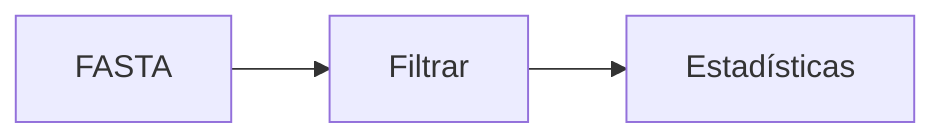

<div class="template-badge">Entornos y ejecución</div>

# Conda y reproducibilidad

<p class="lead">Conservar las herramientas y el procedimiento de un análisis bioinformático.</p>

---
layout: theory
---

## Tres niveles del análisis

| Herramienta | Función | Ejemplo |
|---|---|---|
| Conda | Instalar dependencias en entornos | SeqKit y BLAST |
| Docker | Ejecutar herramientas en una imagen | Filtrar un FASTA |
| Nextflow | Coordinar tareas dependientes | Filtrar → resumir |

Conservar también **datos, versiones y parámetros**.

---

## Conda: entornos separados

Un entorno reúne ejecutables y bibliotecas compatibles.

```bash
conda create -n bioinfo --override-channels \
  -c conda-forge -c bioconda \
  --strict-channel-priority seqkit=2.10 seqtk=1.4
conda activate bioinfo
seqkit version
```

- Los **canales** distribuyen paquetes.
- Activar un entorno cambia las herramientas disponibles en <code>PATH</code>.
- Separar entornos evita conflictos entre análisis.

---

## Usar el entorno sobre un FASTA

```bash
conda activate bioinfo
mkdir -p results

seqkit stats secuencias.fasta
seqkit seq -m 1000 secuencias.fasta > results/filtradas.fasta

conda deactivate
```

**Resultado:** un FASTA con secuencias de al menos 1000 nt.

La longitud mínima debe corresponder al marcador estudiado.

---

## Guardar y reconstruir el entorno

```bash
conda env export -n bioinfo --from-history > environment.yml
conda env create -n bioinfo-copia -f environment.yml
```

El YAML conserva las dependencias solicitadas.

Para registrar paquetes y compilaciones de una misma plataforma:

```bash
conda list -n bioinfo --explicit > paquetes.txt
conda create -n bioinfo-exacto --file paquetes.txt
```

Una versión fijada aporta más control que instalar siempre la última disponible.

---
layout: theory
---

## Docker: imagen y contenedor

<div class="grid grid-cols-2 gap-6 mt-6">
  <div class="panel"><strong>Imagen</strong><p>Herramientas y bibliotecas empaquetadas.</p></div>
  <div class="panel amber"><strong>Contenedor</strong><p>Proceso ejecutado a partir de esa imagen.</p></div>
</div>

Los datos se conectan mediante **montajes**.

La imagen conserva software; las entradas y los resultados pueden permanecer en el equipo.

---

## Crear una imagen con Seqtk

Guardar como <code>Dockerfile</code>:

```dockerfile
FROM debian:bookworm-slim
RUN apt-get update \
    && apt-get install -y --no-install-recommends seqtk \
    && rm -rf /var/lib/apt/lists/*
```

```bash
docker build -t bioinfo-seqtk .
```

**Uso:** disponer de Seqtk sin instalarlo directamente en el sistema.

Registrar la imagen utilizada: los tags y los paquetes disponibles pueden cambiar.

---

## Ejecutar Docker con un FASTA local

Desde la carpeta que contiene <code>secuencias.fasta</code>:

```bash
mkdir -p results
docker run --rm \
  --mount "type=bind,src=$PWD,dst=/datos,readonly" \
  bioinfo-seqtk \
  seqtk seq -L 1000 /datos/secuencias.fasta \
  > results/filtradas.fasta
```

- <code>/datos</code>: ruta visible dentro del contenedor.
- <code>readonly</code>: entrada montada como solo lectura.
- <code>></code>: guarda la salida en el equipo.

---
layout: theory
---

## Nextflow: coordinar etapas



- Un **proceso** define una tarea y sus archivos.
- Un **canal** conecta entradas y salidas.
- El motor organiza ejecución, recursos y reanudación.

Puede combinar Bash, Python, R y herramientas compiladas.

---

## Definir una tarea en Nextflow

Primera parte de <code>main.nf</code>:

```groovy
process FILTRAR {
    conda 'bioconda::seqkit=2.10'
    input:
    path fasta
    output:
    path 'filtradas.fasta'
    script:
    """
    seqkit seq -m 1000 "${fasta}" > filtradas.fasta
    """
}
```

La tarea recibe un FASTA y produce otro con el filtro aplicado.

---

## Conectar una segunda tarea

Continuación de <code>main.nf</code>:

```groovy
process RESUMIR {
    conda 'bioconda::seqkit=2.10'
    publishDir 'results', mode: 'copy'
    input:
    path fasta
    output:
    path 'stats.tsv'
    script:
    """
    seqkit stats -T "${fasta}" > stats.tsv
    """
}
```

El archivo recibido viene de la salida del primer proceso.

---

## Conectar y ejecutar el workflow

Última parte de <code>main.nf</code>:

```groovy
workflow {
    entrada = Channel.fromPath(params.fasta, checkIfExists: true)
    RESUMIR(FILTRAR(entrada))
}
```

Con Nextflow y Conda instalados:

```bash
nextflow run main.nf --fasta secuencias.fasta -with-conda
```

**Salida:** <code>results/stats.tsv</code>.

---

## Reanudar una ejecución

```bash
nextflow run main.nf --fasta secuencias.fasta -with-conda -resume
```

<code>-resume</code> reutiliza tareas válidas de la caché.

Conservar <code>work/</code> y <code>.nextflow/cache/</code>.

**Alternativa:** Snakemake organiza tareas mediante reglas y archivos de entrada/salida.

---
layout: lab
---

## Aplicación: filtrar una colección de NCBI

1. Descargar secuencias con Entrez Direct —semana 06—.
2. Conservar la descarga original y sus accesiones.
3. Filtrar por longitud con Conda o Docker.
4. Encadenar filtrado y estadísticas con Nextflow.

**Registrar:** herramientas, entrada y umbral aplicado.

---

## Documentación

- [Conda · entornos](https://docs.conda.io/projects/conda/en/latest/user-guide/tasks/manage-environments.html)
- [Docker · contenedores](https://docs.docker.com/engine/containers/run/)
- [Nextflow · procesos](https://www.nextflow.io/docs/latest/process.html)
- [Nextflow · Conda](https://www.nextflow.io/docs/latest/conda.html)

