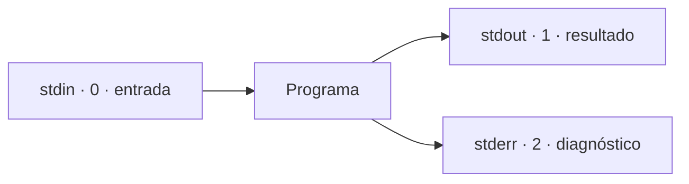

<div class="template-badge">Flujos de datos</div>

# Pipelines y Git

<p class="lead">Conectar herramientas, descargar secuencias y registrar el análisis.</p>

---
layout: theory
---

## stdin, stdout y stderr



**stdout** transporta datos. **stderr** transporta mensajes y errores.

El código de salida indica el estado: **0** suele significar éxito.

---

## Un pipe conecta dos programas

```bash
seqkit seq -m 1000 secuencias.fasta | seqkit stats
```

1. SeqKit selecciona secuencias de al menos 1000 nt.
2. Su stdout pasa al stdin del segundo comando.
3. El segundo comando calcula estadísticas.

No se necesita guardar el FASTA intermedio.

---

## Redirigir los resultados

```bash
seqkit stats secuencias.fasta > resumen.txt 2> errores.log
```

| Operador | Uso |
|---|---|
| <code><</code> | Leer entrada desde archivo |
| <code>></code> | Guardar salida; reemplaza el archivo |
| <code>>></code> | Añadir salida al final |
| <code>2></code> | Guardar stderr |

```bash
seqkit stats < secuencias.fasta
```

---

## Separar datos de mensajes

```bash
seqkit seq -m 1000 secuencias.fasta \
  2> filtro.log | seqkit stats > resumen.txt
```

**filtro.log:** diagnóstico del filtro.

**resumen.txt:** estadísticas de las secuencias retenidas.

Para guardar ambos canales en un mismo log:

```bash
seqkit stats secuencias.fasta > ejecucion.log 2>&1
```

No mezclar mensajes con el FASTA que consumirá otra herramienta.

---

## Detectar fallos en un pipeline

```bash
set -o pipefail
seqkit seq -m 1000 secuencias.fasta | seqkit stats
echo "$?"
```

- Sin <code>pipefail</code>, cuenta el estado del último comando.
- Con <code>pipefail</code>, un fallo anterior también afecta al resultado.
- Un archivo creado puede estar vacío o incompleto.

**Comprobar estado y contenido antes de continuar.**

---
layout: theory
---

## NCBI: buscar y recuperar secuencias

Entrez Direct proporciona dos operaciones:

| Comando | Función |
|---|---|
| <code>esearch</code> | Buscar registros con una consulta |
| <code>efetch</code> | Recuperarlos como FASTA, GenBank o accesiones |

```bash
conda create -n ncbi -c conda-forge -c bioconda \
  ncbi-entrez-direct seqkit
conda activate ncbi
```

---

## Descargar con esearch y efetch

```bash
set -o pipefail
consulta='"Zonotrichia capensis"[Organism] AND mitochondrion[Filter]'

esearch -db nuccore -query "$consulta" \
  | efetch -format fasta > secuencias.fasta

seqkit stats secuencias.fasta
```

- <code>nuccore</code>: registros nucleotídicos.
- La consulta selecciona organismo y origen mitocondrial.
- <code>efetch</code> convierte la selección en FASTA.

El número de registros depende de la consulta y de la fecha.

---

## Conservar la selección descargada

```bash
seqkit seq -n -i secuencias.fasta > accesiones.txt
printf '%s\n' "$consulta" > consulta.txt
date -u +%F > fecha.txt
sha256sum secuencias.fasta > secuencias.sha256
```

**Guardar:** consulta, accesiones con versión, fecha y FASTA original.

Antes de alinear, comprobar que las secuencias correspondan a **regiones homólogas**.

---

## Filtrar registros FASTA completos

```bash
seqkit grep -p KC693267.1 secuencias.fasta > seleccion.fasta

seqkit seq -m 1000 secuencias.fasta > largas.fasta
```

- Primer comando: seleccionar un identificador presente en el archivo.
- Segundo comando: seleccionar por longitud.

Un FASTA puede tener secuencias multilínea: usar herramientas que reconozcan registros.

---

## Guardar un intermedio con tee

```bash
seqkit seq -m 1000 secuencias.fasta \
  | tee largas.fasta \
  | seqkit stats > resumen.txt
```

Se obtienen dos archivos:

- <code>largas.fasta</code>: secuencias seleccionadas.
- <code>resumen.txt</code>: estadísticas.

<code>tee</code> escribe el archivo y mantiene el flujo hacia el siguiente comando.

---

## Combinar Bash y Python

Guardar como <code>contar_clases.py</code>:

```python
import csv
import sys
from collections import Counter

filas = csv.DictReader(sys.stdin)
conteos = Counter(fila["Class"] for fila in filas)
for clase, n in sorted(conteos.items()):
    print(clase, n, sep="\t")
```

Usar el CSV del curso:

```bash
gzip -cd Semana4/Toxicity-13F.csv.gz \
  | python contar_clases.py > clases.tsv
```

Bash descomprime y conecta; Python interpreta el CSV.

---

## Integrar otros lenguajes

```text
FASTA → SeqKit → tabla TSV → Python o R → resumen / figura
```

- Bash conecta programas mediante archivos y flujos.
- Python o R reciben datos con un formato acordado.
- Nextflow o Snakemake coordinan estas etapas como tareas.

**Definir separador, columnas y unidades en cada tabla.**

---

## Caso genómico: SAM a BAM ordenado

Requiere referencia indexada, lecturas y BWA/Samtools instalados:

```bash
set -o pipefail
bwa mem ref.fasta R1.fastq.gz R2.fastq.gz 2> alineamiento.log \
  | samtools sort -o alineamiento.bam -

samtools index alineamiento.bam
```

BWA produce SAM; Samtools lo recibe por stdin y escribe BAM.

Crear el índice después de comprobar que terminó correctamente.

---
layout: theory
---

## Git registra versiones del procedimiento

```text
Editar → git add → git commit
```

Versionar **scripts, parámetros, consultas y entornos**.

Para FASTA o FASTQ grandes, conservar ubicación y checksum en un manifiesto.

```bash
git status
git add analizar.sh environment.yml consulta.txt
git commit -m "Registra análisis mitocondrial"
```

---

## Revisar y comparar cambios

```bash
git diff
git log --oneline -5
git rev-parse HEAD
```

- <code>diff</code>: cambios del contenido.
- <code>log</code>: historial de commits.
- <code>rev-parse HEAD</code>: identificador de la versión actual.

Asociar cada ejecución con sus parámetros y su commit.

---
layout: lab
---

## Ejercicio: de NCBI al resumen

1. Descargar secuencias con <code>esearch | efetch</code>.
2. Conservar consulta, accesiones y checksum.
3. Filtrar por longitud y guardar el intermedio con <code>tee</code>.
4. Separar resultados y diagnóstico.
5. Registrar el procedimiento con Git.

---

## Documentación

- [GNU Bash · pipelines](https://www.gnu.org/software/bash/manual/html_node/Pipelines.html)
- [NCBI · Entrez Direct](https://www.ncbi.nlm.nih.gov/books/NBK179288/)
- [SeqKit · comandos](https://bioinf.shenwei.me/seqkit/usage/)
- [Git · libro oficial](https://git-scm.com/book/es/v2)
