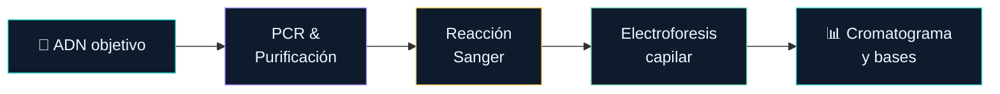

<div class="template-badge">Secuenciación y análisis de lecturas</div>

# Sanger y consenso

<p class="lead">Interpretar cromatogramas, revisar calidad y construir una secuencia consenso.</p>

---
layout: visual-right
image: /images/sanger/sanger-dna.png
fit: contain
credit: Wikimedia Commons · CC BY-SA
sourceUrl: https://commons.wikimedia.org/wiki/File:Sanger-DNA-seq.png
---

## Sanger: determinar el orden de las bases

La polimerasa copia un molde de ADN y genera fragmentos de distintas longitudes.

<v-clicks>

- Cada fragmento termina en una **base identificable** (ddNTP fluorescente).
- La electroforesis capilar separa los fragmentos por tamaño.
- La señal fluorescente permite asignar A, C, G y T.

</v-clicks>

<div class="panel amber mt-4" v-click>
<strong>Aplicaciones</strong><br>
<small>Verificar amplicones · confirmar variantes · revisar insertos de plásmidos</small>
</div>

---
layout: visual-right
image: /images/sanger/ddntp-structure.svg
fit: contain
credit: Wikimedia Commons · CC BY-SA
sourceUrl: https://commons.wikimedia.org/wiki/File:Dideoxyadenosine_triphosphate.svg
---

## dNTP vs ddNTP — el interruptor molecular

<div class="grid grid-cols-1 gap-4 mt-2">

<div class="panel violet" v-click>
<strong>dNTP · desoxirribonucleótido</strong>
<small class="mt-1">Tiene grupo <b style="color:var(--bio-green)">3′-OH libre</b> → permite continuar la cadena</small>
</div>

<div class="panel" style="border-color:var(--bio-danger)" v-click>
<strong style="color:var(--bio-danger)">ddNTP · dideoxirribonucleótido</strong>
<small class="mt-1">Sin 3′-OH → <b style="color:var(--bio-danger)">detiene la extensión</b></small>
</div>

</div>

<p class="muted text-sm mt-4" v-click>Los ddNTP marcados se incorporan al azar entre los dNTP, produciendo fragmentos de <b>todas las longitudes posibles</b>.</p>

---
layout: visual-right
image: /images/sanger/ddntp-termination.png
fit: contain
credit: Wikimedia Commons · CC BY-SA
sourceUrl: https://commons.wikimedia.org/wiki/File:Dideoxy_termination_of_DNA_elongation_PL.png
---

## Reacción de secuenciación

<div class="grid grid-cols-1 gap-4 mt-2">

<div class="panel" v-click>
<strong>🔬 PCR del amplicón</strong>
<ul class="mt-2 text-sm">
  <li>Dos primers (forward + reverse)</li>
  <li>Solo usa <b>dNTP</b></li>
  <li>Producto: muchas copias del fragmento</li>
</ul>
</div>

<div class="panel amber" v-click>
<strong>🧬 Secuenciación Sanger</strong>
<ul class="mt-2 text-sm">
  <li>Un primer por reacción</li>
  <li>Usa <b>dNTP + ddNTP marcados</b></li>
  <li>Producto: fragmentos de distintos tamaños</li>
</ul>
</div>

<div class="warn" v-click>
Para obtener lecturas <b>forward</b> y <b>reverse</b> se realizan <b>dos reacciones independientes</b>.
</div>

</div>

---
layout: theory
---

## Del amplicón al cromatograma



<div class="grid grid-cols-3 gap-3 mt-4">
<div class="count"><strong>1°</strong><small>Fragmentos cortos llegan primero al detector</small></div>
<div class="count"><strong>5′→3′</strong><small>Dirección de síntesis y lectura</small></div>
<div class="count"><strong>~800 pb</strong><small>Longitud típica de lectura útil</small></div>
</div>

---

## Archivos que debemos conservar

<div class="grid grid-cols-3 gap-4 mt-4">

<div class="panel" v-click>
<strong style="color:var(--bio-cyan)">AB1</strong>
<small class="mt-2">Señales brutas, bases y calidad Phred</small>
<small class="mt-2">→ <b>Revisar cromatogramas con un visor de trazas</b></small>
</div>

<div class="panel" v-click>
<strong style="color:var(--bio-violet)">FASTQ</strong>
<small class="mt-2">Bases y calidad Phred por posición</small>
<small class="mt-2">→ <b>Procesar, filtrar y recortar calidad</b></small>
</div>

<div class="panel" v-click>
<strong style="color:var(--bio-gold)">FASTA</strong>
<small class="mt-2">Identificador y secuencia, sin calidad</small>
<small class="mt-2">→ <b>Alinear y comparar con bases de datos</b></small>
</div>

</div>

<div class="warn mt-5" v-click>
⚠️ <b>Conservar los AB1 originales.</b> Un FASTA no permite recuperar la forma de los picos ni la calidad original.
</div>

---
layout: figure
caption: "Cromatograma Sanger real: cada color corresponde a una base. Se observan picos separados sobre fondo bajo — señal de buena calidad."
source: Wikimedia Commons · Sanger Trace CutePeaks
sourceUrl: https://commons.wikimedia.org/wiki/File:Sanger_Trace_CutePeaks_abcZ_F.png
---

## Leer un cromatograma


<div class="grid grid-cols-3 gap-3 mt-3 text-sm">
<div class="step"><b>✅ Bueno</b><small>Picos altos, separados, sin ruido de fondo</small></div>
<div class="step"><b>⚠️ Revisar</b><small>Picos solapados o señal de fondo elevada</small></div>
<div class="step"><b>❌ Descartar</b><small>Señal sin forma definida, bases no asignables</small></div>
</div>

---
layout: theory
---

## Calidad por base: escala Phred

<div class="grid grid-cols-2 gap-6">

<div>

$$
Q = -10\log_{10}(P_{\mathrm{error}})
$$

<div class="stat-flow mt-6" v-click>
  <div><strong>Q10</strong><small>10 % error</small></div>
  <i>→</i>
  <div><strong>Q20</strong><small>1 % error</small></div>
  <i>→</i>
  <div><strong>Q30</strong><small>0.1 % error</small></div>
</div>

<div class="warn mt-5" v-click>
La calidad describe <b>una base</b>, no garantiza que toda la lectura sea correcta.<br>
<small>Q20 = umbral mínimo habitual · Q30 = estándar alto</small>
</div>

</div>

<div v-click>

<p class="muted text-xs mt-1 text-center">Cromatograma con bases y calidad asignadas · Wikimedia Commons</p>
</div>

</div>

---
layout: theory
---

## Recortar regiones poco confiables

<div class="grid grid-cols-3 gap-4 mt-4">

<div class="panel" style="border-color:var(--bio-danger); text-align:center">
<strong style="color:var(--bio-danger)">Inicio ruidoso</strong>
<small class="mt-2">El primer centenar de bases suele tener señal irregular. <b>Recortar.</b></small>
</div>

<div class="panel green" style="text-align:center">
<strong style="color:var(--bio-green)">✅ Región clara</strong>
<small class="mt-2">Picos definidos, calidad suficiente. <b>Conservar.</b></small>
</div>

<div class="panel" style="border-color:var(--bio-danger); text-align:center">
<strong style="color:var(--bio-danger)">Cola degradada</strong>
<small class="mt-2">La calidad cae hacia el final. <b>Recortar.</b></small>
</div>

</div>

```
Lectura:  ████ [inicio ruidoso] ████████████████████ [región clara] ███ [cola]
Conservar:                      ████████████████████
```

<v-clicks>

- Delimitar el tramo con señal y calidad suficientes.
- Retirar regiones de primers cuando no formen parte del objetivo.
- Bases internas dudosas → marcar como **ambiguas (IUPAC)**, no eliminar.
- **No recortar siempre el mismo número de bases:** revisar cada lectura.

</v-clicks>

---
layout: theory
---

## Picos dobles y señal mezclada

<div class="grid grid-cols-3 gap-4 mt-3">

<div class="panel violet" v-click>
<strong>Dos picos en una posición</strong>
<small class="mt-2">Heterocigosis, mezcla de moldes, o artefacto de PCR</small>
</div>

<div class="panel" style="border-color:var(--bio-danger)" v-click>
<strong style="color:var(--bio-danger)">Picos solapados en gran parte</strong>
<small class="mt-2">Mezcla de moldes o amplificación inespecífica → repetir o rediseñar</small>
</div>

<div class="panel amber" v-click>
<strong>Desfase desde una posición</strong>
<small class="mt-2">Indel heterocigoto o mezcla → revisar contexto del ensayo</small>
</div>

</div>

<div class="grid grid-cols-2 gap-4 mt-4" v-click>


<div class="warn">
Revisar ambas direcciones y el contexto biológico del ensayo.<br>
<b>Un pico doble aislado no demuestra una variante.</b>
</div>

</div>

---
layout: visual-right
image: /images/sanger/capillary-electrophoresis.jpg
fit: contain
credit: Wikimedia Commons · CC BY-SA
sourceUrl: https://commons.wikimedia.org/wiki/File:CE_Basic.jpg
---

## Forward y reverse: complemento reverso

La lectura **reverse** lee el molde en sentido 3′→5′, por lo que su secuencia debe transformarse antes de compararla con la forward.

<v-clicks>

1. **Invertir el orden** de los nucleótidos
2. **Complementar** cada base (A↔T, G↔C)

</v-clicks>

<div class="panel green mt-4" v-click>

```text
Forward:         5′-ATGCCATA-3′
Reverse (raw):   5′-TATGGCAT-3′
Rev. comp.:      5′-ATGCCATA-3′  ✅
```

<small class="mt-2">Invertir el orden <b>sin</b> complementar las bases es un error frecuente.</small>

</div>

---
layout: theory
---

## Orientar una lectura desde la terminal

Con **SeqKit** instalado y la lectura reverse exportada a FASTA:

```bash
seqkit seq --reverse --complement reverse.fasta > reverse_rc.fasta
```

<div class="grid grid-cols-2 gap-5 mt-4">

<div class="panel">
<strong>Flags utilizados</strong>
<ul class="mt-2 text-sm">
  <li><code>-r</code> / <code>--reverse</code>: invertir el orden de las bases</li>
  <li><code>-p</code> / <code>--complement</code>: complementar las bases</li>
</ul>
</div>

<div class="panel amber">
<strong>Buenas prácticas</strong>
<ul class="mt-2 text-sm">
  <li>Conservar <code>reverse.fasta</code> como original</li>
  <li>Trabajar sobre la copia orientada <code>reverse_rc.fasta</code></li>
  <li>Verificar el resultado comparando con la forward</li>
</ul>
</div>

</div>

---
layout: theory
---

## Alinear las dos lecturas

```text
Forward:    5′──ATGCCATAGCTA──────────3′
                 ||||||||
Reverse RC: 5′──────CATAGCTAGGAC──────3′
                 Solapamiento: CATAGCTA
```

<div class="grid grid-cols-3 gap-4 mt-4">

<div class="count" v-click><strong>1.</strong><small>Buscar solapamiento suficiente y coherente</small></div>
<div class="count" v-click><strong>2.</strong><small>Revisar discrepancias en los cromatogramas originales</small></div>
<div class="count" v-click><strong>3.</strong><small>Si no hay solapamiento, NO inventar las bases intermedias</small></div>

</div>

<p class="muted text-sm mt-4" v-click>El alineamiento propone correspondencias; la calidad Phred en cada AB1 respalda las decisiones finales.</p>

---
layout: theory
---

## Construir el consenso

<div class="grid grid-cols-2 gap-4 mt-3">

<div class="panel green" v-click>
<strong>✅ Ambas coinciden y son claras</strong>
<small class="mt-2">→ Conservar la base con confianza</small>
</div>

<div class="panel violet" v-click>
<strong>Una clara · otra ruidosa</strong>
<small class="mt-2">→ Revisar AB1 y apoyar la llamada con mejor evidencia</small>
</div>

<div class="panel amber" v-click>
<strong>Dos bases en molde diploide</strong>
<small class="mt-2">→ Usar código IUPAC si la evidencia lo respalda en ambas lecturas</small>
</div>

<div class="panel" style="border-color:var(--bio-danger)" v-click>
<strong style="color:var(--bio-danger)">Señal insuficiente para decidir</strong>
<small class="mt-2">→ Marcar <b>N</b> o repetir la reacción</small>
</div>

</div>

<p class="muted text-sm mt-4">Con solo dos lecturas, una discrepancia <b>no se resuelve por mayoría.</b></p>

---
layout: theory
---

## Códigos IUPAC de ambigüedad

<div class="grid grid-cols-2 gap-6">

<div>

| Código | Bases | Mnemónico |
|:---:|:---:|---|
| **R** | A o G | pu**R**ina |
| **Y** | C o T | pirimidina (**Y**) |
| **S** | G o C | fuerte (**S**trong) |
| **W** | A o T | débil (**W**eak) |
| **M** | A o C | a**M**ino |
| **K** | G o T | **K**eto |
| **N** | A,C,G,T | a**N**y |

</div>

<div v-click>

<p class="muted text-xs mt-1 text-center">Gel de secuenciación · Wikimedia Commons</p>
</div>

</div>

<p class="muted text-xs mt-3">IUPAC expresa ambigüedad <em>respaldada</em>; <b>N</b> deja la posición sin resolver. No asignar R o Y automáticamente a cualquier señal mezclada.</p>

---
layout: theory
---

## Ejemplo: resolver una discrepancia

```text
Posición:    1  2  3  4  5  6
Forward:     A  T  G  C  A  T
Reverse RC:  A  T  G  C  G  T
                          ↑
                     Discrepancia
```

<div class="grid grid-cols-3 gap-4 mt-5">

<div class="panel green" v-click>
<strong>Caso 1</strong>
<small>Forward claro (Q30), reverse ruidoso (Q12) en pos. 5</small>
<small class="mt-2">→ Considerar <b>A</b> tras revisar el trazado</small>
</div>

<div class="panel violet" v-click>
<strong>Caso 2</strong>
<small>Señal A/G reproducible en ambas direcciones, biológicamente compatible</small>
<small class="mt-2">→ Considerar <b>R</b></small>
</div>

<div class="panel" style="border-color:var(--bio-danger)" v-click>
<strong style="color:var(--bio-danger)">Caso 3</strong>
<small>Evidencia insuficiente o trazados poco claros en ambas lecturas</small>
<small class="mt-2">→ <b>N</b> o repetir la lectura</small>
</div>

</div>

---
layout: theory
---

## Herramientas del flujo de trabajo

<div class="grid grid-cols-2 gap-4 mt-3">

<div class="panel" v-click>
<strong style="color:var(--bio-cyan)">🔭 <a href="https://ugene.net/" target="_blank" style="color:var(--bio-cyan)">UGENE</a> · visor de trazas</strong>
<small class="mt-2">Abrir AB1 y revisar picos, calidad y señal de fondo. Gratuito y multiplataforma.</small>
<small class="mt-1"><a href="https://ugene.net/download-all.html" target="_blank">↓ Descargar UGENE</a></small>
</div>

<div class="panel amber" v-click>
<strong>🐍 ASAP.py · pipeline automatizado</strong>
<small class="mt-2">Recorte, orientación y consenso de pares forward/reverse desde la terminal.</small>
<small class="mt-1"><a href="https://github.com/addityea/ASAP" target="_blank">↗ github.com/addityea/ASAP</a></small>
</div>

<div class="panel violet" v-click>
<strong>🔬 Biopython</strong>
<small class="mt-2">Leer bases, calidades y construir consenso manualmente con Python.</small>
</div>

<div class="panel green" v-click>
<strong>⚙️ SeqKit</strong>
<small class="mt-2">Complemento reverso, estadísticas y conversión de formatos desde la terminal.</small>
</div>

</div>

<div class="stat-flow mt-4" v-click>
  <div><small>Abrir<br>AB1</small></div><i>→</i>
  <div><small>Revisar<br>UGENE</small></div><i>→</i>
  <div><small>Recortar</small></div><i>→</i>
  <div><small>Orientar<br>RC</small></div><i>→</i>
  <div><small>Alinear</small></div><i>→</i>
  <div><small>ASAP.py<br>/ Biopython</small></div><i>→</i>
  <div><small>Exportar<br>FASTA</small></div>
</div>

---
layout: theory
---

## UGENE: visualizar el cromatograma AB1

<div class="grid grid-cols-2 gap-5 mt-3">

<div>

**Descargar e instalar:**

```bash
# Ubuntu / Debian
sudo apt install ugene

# Conda (alternativa)
conda install -c bioconda ugene
```

**Abrir un AB1:**

```bash
ugene muestra_F.ab1
```

</div>

<div class="panel" v-click>
<strong style="color:var(--bio-cyan)">Qué revisar en UGENE</strong>
<ul class="text-sm mt-2">
  <li>Forma y altura de cada pico</li>
  <li>Ruido de fondo en la señal</li>
  <li>Región de baja calidad al inicio y al final</li>
  <li>Picos dobles (posible heterocigosis o mezcla)</li>
  <li>Calidad Phred por posición (barra inferior)</li>
</ul>
<small class="mt-3 block">→ <a href="https://ugene.net/wiki/display/UUOUM/Working+with+Chromatogram+Viewer" target="_blank">Documentación del visor de cromatogramas</a></small>
</div>

</div>

---
layout: theory
---

## ASAP.py: instalación

**ASAP** (Automated Sanger Analysis Pipeline) automatiza el recorte, orientación y consenso

```bash {1-2|4-5|7-9|11-12}
# 1. Dependencias del sistema
sudo apt install emboss seqtk python3 python3-pip ncbi-blast+ clustalw

# 2. Biopython
pip3 install biopython

# 3. Clonar el repositorio
git clone https://github.com/addityea/ASAP.git
cd ASAP

# 4. Agregar al PATH (crear symlink)
sudo ln -s $PWD/ASAP.py /usr/local/bin/ASAP.py
```

<div class="grid grid-cols-3 gap-3 mt-4">
<div class="count" v-click><strong>EMBOSS</strong><small>Herramientas bioinformáticas: recorte, traducción</small></div>
<div class="count" v-click><strong>seqtk</strong><small>Manipulación rápida de FASTQ/FASTA</small></div>
<div class="count" v-click><strong>BLAST+</strong><small>Alineamiento contra referencia local</small></div>
</div>

---
layout: theory
---

## ASAP.py: uso básico

```bash
# Sintaxis
ASAP.py <prefijo_salida> <forward.ab1> <reverse.ab1> <referencia.fasta>

# Ejemplo con Fasciola hepatica COI
ASAP.py muestra01 \
  15.10F_003_C04_2016-05-19.ab1 \
  15.10R_004_D04_2016-05-19.ab1 \
  referencias/COI_reference.fasta
```

<div class="grid grid-cols-2 gap-5 mt-4">

<div class="panel">
<strong>Archivos de entrada</strong>
<ul class="mt-2 text-sm">
  <li><code>forward.ab1</code> — lectura F (original)</li>
  <li><code>reverse.ab1</code> — lectura R (original)</li>
  <li><code>referencia.fasta</code> — secuencia de referencia</li>
</ul>
</div>

<div class="panel amber" v-click>
<strong>Qué hace ASAP internamente</strong>
<ul class="mt-2 text-sm">
  <li>Convierte AB1 → FASTQ</li>
  <li>Recorta extremos de baja calidad</li>
  <li>Aplica complemento reverso a la lectura R</li>
  <li>Alinea F + RC(R) contra la referencia</li>
  <li>Exporta el <b>consenso FASTA</b></li>
</ul>
</div>

</div>

---
layout: theory
---

## ASAP.py: procesar múltiples muestras

Para procesar todas las muestras de forma iterativa:

```bash {1-5|7-13|15-16}
# Organizar archivos por muestra
mkdir -p resultados
ls *.ab1 | sed 's/_[FR]_.*//' | sort -u
# → muestra01, muestra02, muestra03, ...

# Bucle bash para procesar pares F/R
for muestra in $(ls *F_*.ab1 | sed 's/F_.*//' | sort -u); do
  forward=$(ls ${muestra}F_*.ab1 2>/dev/null | head -1)
  reverse=$(ls ${muestra}R_*.ab1 2>/dev/null | head -1)
  [ -f "$forward" ] && [ -f "$reverse" ] && \
    ASAP.py resultados/${muestra} "$forward" "$reverse" referencia.fasta
done

# Reunir todos los consensos en un multifasta
cat resultados/*.fasta > todos_consensos.fasta
seqkit stats todos_consensos.fasta
```

<div class="warn mt-3" v-click>
Verificar que cada par F/R corresponda a la <b>misma muestra y marcador</b> antes de procesar en lote.
</div>

---

## Biopython (1/2): leer, recortar y orientar

```python {1-6|7-16|18-22}
from Bio import SeqIO, SeqRecord, Seq
from Bio.Align import PairwiseAligner
# --- 1. Leer ambos AB1 ---
fwd = SeqIO.read("muestra_F.ab1", "abi")
rev = SeqIO.read("muestra_R.ab1", "abi")
# --- 2. Recortar por calidad Phred (ventana deslizante) ---
def recortar(rec, umbral=20, ventana=10):
    cal = rec.letter_annotations["phred_quality"]
    inicio = next((i for i in range(len(cal)-ventana)
                   if sum(cal[i:i+ventana])/ventana >= umbral), 0)
    fin = len(cal) - next((i for i in range(len(cal)-ventana)
                   if sum(cal[-(i+ventana):-i or None])/ventana >= umbral), 0)
    return rec[inicio:fin]

fwd_trim = recortar(fwd)
rev_trim  = recortar(rev)
# --- 3. Complemento reverso de la lectura R ---
rev_rc = rev_trim.reverse_complement(id=rev_trim.id + "_rc",
                                      description="rev comp")
```

<div class="grid grid-cols-3 gap-3 mt-3">
<div class="count"><strong>Paso 1</strong><small>Leer AB1 con <code>SeqIO</code></small></div>
<div class="count"><strong>Paso 2</strong><small>Recortar extremos Q &lt; 20</small></div>
<div class="count"><strong>Paso 3</strong><small>RC de lectura reverse</small></div>
</div>

---

## Biopython (2/2): alinear y exportar

```python {1-6|8-10|11-13}
# --- 4. Alinear F y RC(R) localmente ---
aligner = PairwiseAligner()
aligner.mode = "local"
aln = aligner.align(str(fwd_trim.seq), str(rev_rc.seq))[0]
print(aln)

# --- 5. Exportar las lecturas orientadas ---
SeqIO.write([fwd_trim, rev_rc], "lecturas_orientadas.fasta", "fasta")

# --- 6. Ver estadísticas rápidas ---
import subprocess
subprocess.run(["seqkit", "stats", "lecturas_orientadas.fasta"])
```

```bash
python consenso_biopython.py
```

<div class="warn mt-3">
El alineamiento local muestra el solapamiento entre F y RC(R).<br>
<small>Las coordenadas de inicio/fin del solapamiento se usan en el paso siguiente para construir el consenso.</small>
</div>

---

## Exportar el consenso final

```text
>muestra01_COI_consenso
ATGCCATAGCTAGGAC...
```

<div class="grid grid-cols-2 gap-5 mt-4">

<div class="panel">
<strong>📁 Archivos a conservar junto al FASTA</strong>
<ul class="mt-2 text-sm">
  <li>AB1 forward y reverse <b>originales</b></li>
  <li>Regiones recortadas (posición de inicio y fin)</li>
  <li>Posiciones corregidas o marcadas como ambiguas</li>
  <li>Identificador de muestra y marcador (p. ej. <i>COI</i>)</li>
</ul>
</div>

<div class="panel amber">
<strong>📋 Registro mínimo de decisiones</strong>
<ul class="mt-2 text-sm">
  <li>Rango útil de cada lectura (pb)</li>
  <li>Posiciones con discrepancia y resolución adoptada</li>
  <li>Código IUPAC utilizado o N asignada</li>
  <li>Longitud final del consenso</li>
</ul>
</div>

</div>

<p class="muted text-sm mt-3">El consenso debe poder relacionarse con la evidencia original en cualquier momento.</p>

---
layout: lab
---

## Práctica: consenso de *Secuencia ncbi sra*

<div class="grid grid-cols-2 gap-6 mt-2">

<div>

**Pasos con ASAP.py**

<v-clicks>

1. Revisar los AB1 en **UGENE** (picos, calidad).
2. Ejecutar `ASAP.py` para cada par F/R.
3. Revisar el consenso generado.
4. Reunir todos los consensos en un **multifasta**.
5. Alinear con MAFFT (clase 10).
6. Construir la filogenia (clase 11).

</v-clicks>

</div>

<div>

<div class="panel green mt-2" v-click>
<strong>Entrega</strong>
<ul class="text-sm mt-2">
  <li>Consenso FASTA por muestra</li>
  <li>Multifasta con todas las muestras</li>
  <li>Longitud final y posiciones ambiguas</li>
</ul>
</div>

<div class="warn mt-3" v-click>
<small>Verificar cada consenso antes de unirlo al multifasta. Un consenso de mala calidad contamina todo el alineamiento posterior.</small>
</div>

<div class="panel amber mt-3" v-click>
<strong>Alternativa manual</strong>
<small class="mt-1">Usar el script Biopython si ASAP.py no resuelve un par problemático.</small>
</div>

</div>

</div>

---
layout: theory
---

## Documentación y recursos

<div class="grid grid-cols-2 gap-4 mt-3">

<div class="panel">
<strong>🧪 Thermo Fisher · Sanger</strong>
<ul class="text-sm mt-2">
  <li><a href="https://www.thermofisher.com/us/en/home/technical-resources/technical-reference-library/capillary-electrophoresis-applications-support-center/sanger-sequencing-support/sanger-sequencing-support-getting-started.html" target="_blank">Fundamento y preparación</a></li>
  <li><a href="https://www.thermofisher.com/blog/behindthebench/sanger-sequencing-by-ce-4-bioinformatics/" target="_blank">Calidad y análisis bioinformático</a></li>
  <li><a href="https://www.thermofisher.com/TFS-Assets/LSG/manuals/MAN0014435_Trbleshoot_Sanger_seq_data_UB.pdf" target="_blank">Interpretación de problemas del trazado</a></li>
</ul>
</div>

<div class="panel violet">
<strong>⚙️ Herramientas</strong>
<ul class="text-sm mt-2">
  <li><a href="https://github.com/addityea/ASAP" target="_blank">ASAP.py · pipeline automático Sanger</a></li>
  <li><a href="https://ugene.net/download-all.html" target="_blank">UGENE · visor de cromatogramas AB1</a></li>
  <li><a href="https://biopython.org/wiki/SeqIO.html" target="_blank">Biopython · SeqIO y formatos</a></li>
  <li><a href="https://bioinf.shenwei.me/seqkit/usage/" target="_blank">SeqKit · operaciones de secuencia</a></li>
</ul>
</div>

</div>

<div class="panel amber mt-4">
<strong>📖 Lectura recomendada</strong>
<small>Ewing & Green (1998) · <i>Base-calling of automated sequencer traces using Phred. II. Error probabilities.</i> Genome Research.</small>
</div>
