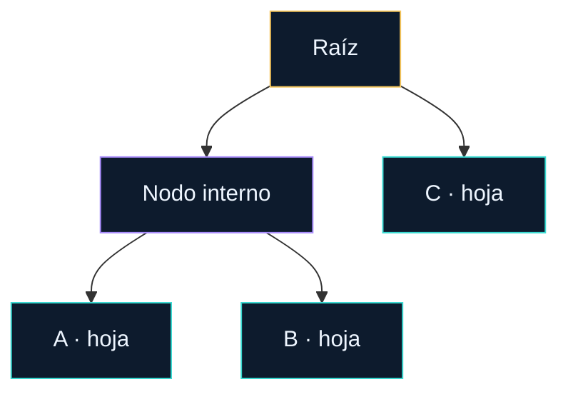
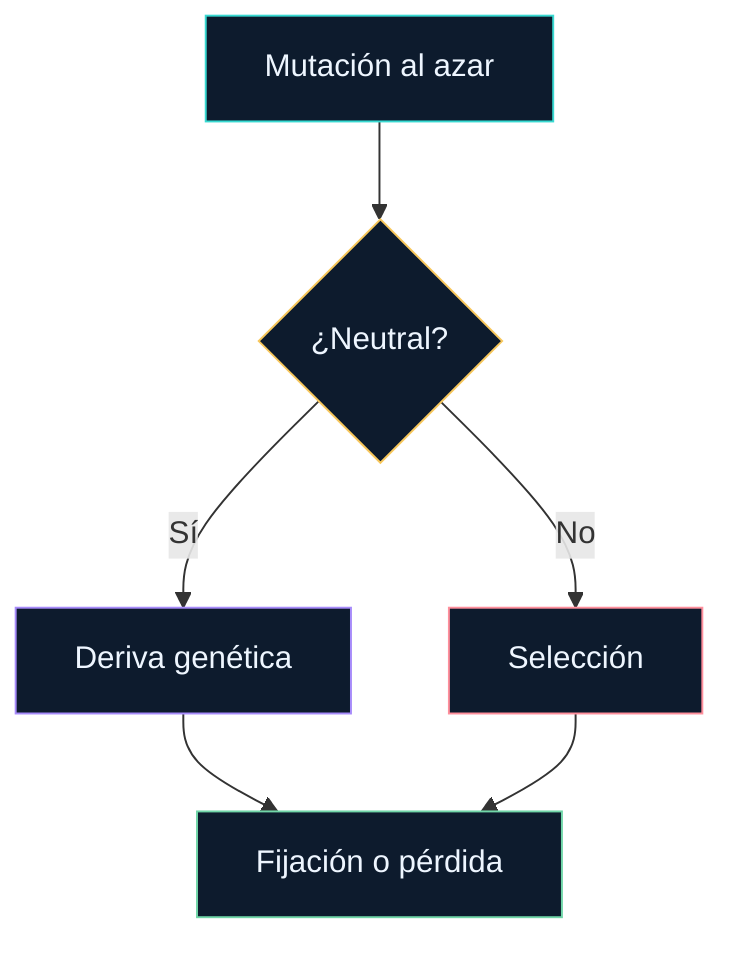
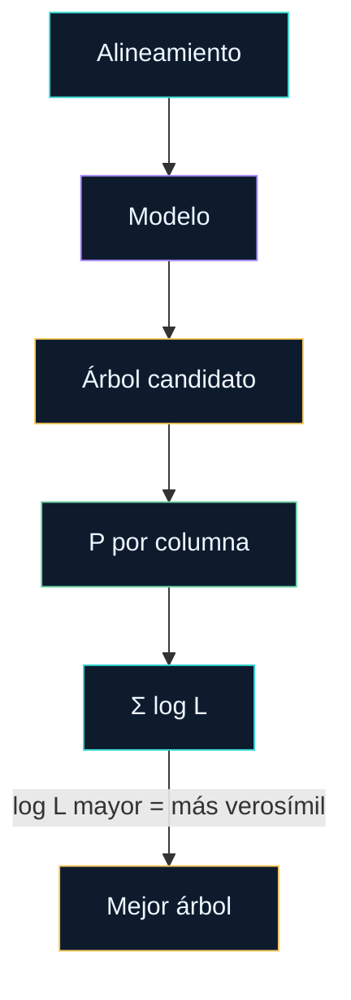
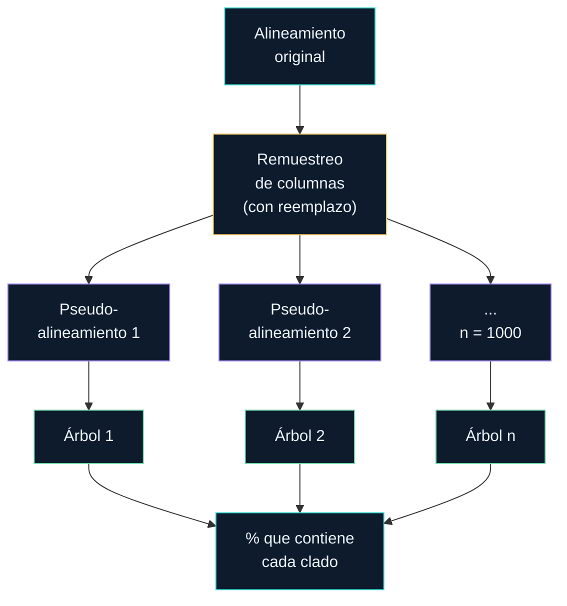

<div class="template-badge">Reconstrucción filogenética</div>

# Filogenia molecular

<p class="lead">Del alineamiento a un árbol de máxima verosimilitud con metadatos.</p>

---
layout: theory
---

## Flujo de trabajo completo


<div class="grid grid-cols-3 gap-3 mt-4">
<div class="count"><strong>Clase 09</strong><small>Consenso Sanger</small></div>
<div class="count"><strong>Clase 10</strong><small>BLAST + MSA</small></div>
<div class="count"><strong>Clase 11</strong><small>Filogenia y visualización</small></div>
</div>

---
layout: visual-right
image: /images/phylo/newick.svg
fit: contain
position: center
credit: Wikimedia Commons · CC BY-SA
sourceUrl: https://en.wikipedia.org/wiki/Newick_format
---

## Leer un árbol filogenético

```text
((A:0.01,B:0.01)95:0.02,C:0.04);
```

<v-clicks>

- **Topología:** A y B forman un clado (grupo monofilético).
- **Longitud de rama:** sustituciones estimadas por sitio.
- **Soporte:** 95 = soporte de la agrupación A–B.
- **Raíz:** requiere un **grupo externo** con justificación biológica.

</v-clicks>

<div class="warn mt-3" v-click>
El orden vertical de las puntas puede cambiar <b>sin alterar la topología</b>. Solo la ramificación importa.
</div>

---
layout: theory
---

## Componentes de un árbol

<div class="grid grid-cols-2 gap-5">

<div>



</div>

<div class="grid grid-cols-1 gap-3">

<div class="panel amber" v-click>
<strong>Raíz</strong>
<small>Punto de partida evolutivo. Requiere grupo externo.</small>
</div>

<div class="panel violet" v-click>
<strong>Nodo interno</strong>
<small>Ancestro hipotético común. No observado directamente.</small>
</div>

<div class="panel" v-click>
<strong>Hoja (punta / OTU)</strong>
<small>Taxón observado. Unidad taxonómica operacional.</small>
</div>

<div class="panel green" v-click>
<strong>Rama</strong>
<small>Longitud = cambio estimado. Conecta nodos.</small>
</div>

</div>

</div>

---
layout: theory
---

## Evolución neutral y marcadores moleculares

<div class="grid grid-cols-2 gap-5 mt-3">

<div>

<div class="panel" v-click>
<strong style="color:var(--bio-cyan)">Mutación neutral</strong>
<small class="mt-2">No cambia la aptitud en el contexto considerado. Su frecuencia cambia por <b>deriva genética</b>.</small>
</div>

<div class="panel amber mt-3" v-click>
<strong>Modelo neutral clásico</strong>
<small class="mt-2">La tasa de fijación de mutaciones neutrales ≈ su tasa de aparición (bajo los supuestos del modelo).</small>
</div>

<div class="panel violet mt-3" v-click>
<strong>Reloj molecular</strong>
<small class="mt-2">Si las mutaciones se acumulan a tasa constante, las distancias genéticas reflejan tiempo de divergencia.</small>
</div>

</div>

<div v-click>

<div class="flex justify-center">


</div>

<p class="muted text-xs mt-2"><b>COI codifica una proteína.</b> Sus sitios pueden estar bajo restricciones distintas.</p>

</div>

</div>

---
layout: visual-right
image: /images/phylo/substitution.svg
fit: contain
position: center
credit: Wikimedia Commons · CC BY-SA
sourceUrl: https://commons.wikimedia.org/wiki/File:All_transitions_and_transversions.svg
---

## Transiciones y transversiones

<div class="grid grid-cols-1 gap-3 mt-2">

<div class="panel amber" v-click>
<strong>Transiciones (ti)</strong>
<small class="mt-1">Purina ↔ purina: <b>A ↔ G</b><br>Pirimidina ↔ pirimidina: <b>C ↔ T</b></small>
<small class="mt-1">Más frecuentes</small>
</div>

<div class="panel violet" v-click>
<strong>Transversiones (tv)</strong>
<small class="mt-1">Purina ↔ pirimidina: <b>A ↔ C, A ↔ T, G ↔ C, G ↔ T</b></small>
<small class="mt-1">Menos frecuentes, pero son 4 tipos vs 2</small>
</div>

</div>

<p class="muted text-xs mt-3" v-click>La relación <b>ti/tv</b> es un parámetro clave de los modelos de sustitución. En COI típicamente ti/tv &gt; 1.</p>

---
layout: theory
---

## Modelos de sustitución nucleotídica

<div class="grid grid-cols-2 gap-4 mt-3">

<div class="panel" v-click>
<strong style="color:var(--bio-cyan)">JC69</strong>
<small class="mt-1">Frecuencias iguales · <b>Una sola tasa</b> de cambio</small>
<small class="mt-1">El modelo más simple</small>
</div>

<div class="panel amber" v-click>
<strong>K80 (Kimura 2P)</strong>
<small class="mt-1">Frecuencias iguales · <b>Distingue ti vs tv</b></small>
<small class="mt-1">Dos parámetros</small>
</div>

<div class="panel violet" v-click>
<strong>HKY85</strong>
<small class="mt-1">Frecuencias <b>pueden diferir</b> · Distingue ti vs tv</small>
<small class="mt-1">Más realista para muchos marcadores</small>
</div>

<div class="panel green" v-click>
<strong>GTR</strong>
<small class="mt-1">Frecuencias <b>pueden diferir</b> · <b>6 tasas</b> relativas</small>
<small class="mt-1">Modelo general reversible</small>
</div>

</div>

<div class="stat-flow mt-4" v-click>
  <div><strong style="font-size:0.7em">JC69</strong><small>1 parámetro</small></div><i>→</i>
  <div><strong style="font-size:0.7em">K80</strong><small>2 parámetros</small></div><i>→</i>
  <div><strong style="font-size:0.7em">HKY</strong><small>5 parámetros</small></div><i>→</i>
  <div><strong style="font-size:0.7em">GTR</strong><small>9 parámetros</small></div>
</div>

<p class="muted text-xs mt-3" v-click><b>+G4</b> aproxima con 4 categorías las diferencias de tasa entre sitios. <b>+I</b> modela sitios invariables.</p>

---
layout: theory
---

## Distancia genética y matriz de distancias

```text
           Sitio:  1  2  3  4  5  6
Seq A:             A  C  G  T  A  C
Seq B:             A  C  A  T  A  C     ← 1 diferencia
Seq C:             A  T  A  T  G  C     ← 3 diferencias con A
```

<div class="grid grid-cols-2 gap-5 mt-4">

<div>

| p-distance | A | B | C |
|---|---:|---:|---:|
| **A** | 0 | 1/6 | 3/6 |
| **B** | 1/6 | 0 | 2/6 |
| **C** | 3/6 | 2/6 | 0 |

</div>

<div v-click>

<div class="panel amber">
<strong>Distancia p</strong>
<small class="mt-1">= diferencias / sitios comparados</small>
<small class="mt-2">Simple pero <b>subestima</b> las sustituciones reales por cambios múltiples en un mismo sitio.</small>
</div>

<div class="warn mt-3">
Declara cómo trataste los gaps y las bases ambiguas.
</div>

</div>

</div>

---
layout: theory
---

## Corrección por sustituciones múltiples

<div class="grid grid-cols-2 gap-5 mt-2">

<div>

En un mismo sitio puede ocurrir **más de un cambio**. Solo vemos el estado final.

$$
d_{JC69}=-\frac{3}{4}\ln\left(1-\frac{4p}{3}\right)
$$

<div class="panel green mt-3" v-click>
<strong>Ejemplo A–B</strong>
<small class="mt-1">

$p = 1/6$

</small>
<small>

$d_{JC69} \approx 0.188$ sustituciones/sitio

</small>
<small class="mt-1">Mayor que $p$ porque corrige por cambios ocultos</small>
</div>

</div>

<div v-click>

  <div class="flex justify-center">

  ```mermaid {scale: 0.8}
  graph TD
    O["Sitio original: A"] --> C1["Cambio 1: A → G"]
    C1 --> C2["Cambio 2: G → A"]
    C2 --> F["Estado final: A"]

    style O fill:#0d1b2d,stroke:#38d9d1,color:#eef6ff
    style C1 fill:#0d1b2d,stroke:#a78bfa,color:#eef6ff
    style C2 fill:#0d1b2d,stroke:#f7c75c,color:#eef6ff
    style F fill:#0d1b2d,stroke:#ff8f9c,color:#eef6ff
  ```
  </div>

<p class="muted text-xs mt-2">2 cambios → observamos <b>0 diferencias</b>. La distancia p subestima el cambio.</p>

<div class="warn m-1 p-1 text-xs"> 

La fórmula deja de dar distancia finita cuando $p$ alcanza $0.75$.
</div>

</div>

</div>

---
layout: theory
---

## Métodos de reconstrucción filogenética

<div class="grid grid-cols-2 gap-5 mt-3">

<div class="panel amber" v-click>
<strong style="font-size:1em">📏 Basados en distancia</strong>
<small class="mt-2"><b>Neighbor Joining (NJ)</b></small>
<small>Agrupa las secuencias más cercanas iterativamente a partir de la matriz de distancias.</small>
<small class="mt-2 block" style="color:var(--bio-green)">✅ Rápido</small>
<small style="color:var(--bio-danger)">❌ No evalúa alternativas</small>
</div>

<div class="panel violet" v-click>
<strong style="font-size:1em">📊 Máxima verosimilitud (ML)</strong>
<small class="mt-2"><b>IQ-TREE, RAxML, PhyML</b></small>
<small>Busca el árbol + parámetros que maximizan la probabilidad de los datos bajo un modelo.</small>
<small class="mt-2 block" style="color:var(--bio-green)">✅ Riguroso, usa toda la información</small>
<small style="color:var(--bio-danger)">❌ Más lento, necesita modelo explícito</small>
</div>

</div>

<div class="panel green mt-4" v-click>
<strong style="font-size:1em">🎲 Inferencia bayesiana</strong>
<small class="mt-2"><b>MrBayes, BEAST</b> · Combina verosimilitud con distribuciones previas · MCMC muestrea la posterior.</small>
<small>Probabilidad posterior ≠ bootstrap ≠ UFBoot. <b>Esta práctica usa ML con IQ-TREE.</b></small>
</div>

---
layout: theory
---

## Máxima verosimilitud — paso a paso

<div class="grid grid-cols-2 gap-5">

<div>

<div class="flex justify-center">


</div>

</div>

<div class="gap-1">

<div class="count mb-2" v-click><strong>1.</strong><small>Calcula P de cada columna para un árbol candidato</small></div>
<div class="count mb-2" v-click><strong>2.</strong><small>Integra estados ancestrales posibles en cada nodo interno</small></div>
<div class="count mb-2" v-click><strong>3.</strong><small>Compara: <b>log L = −1204</b> es mejor que <b>log L = −1236</b></small></div>

<div class="warn text-md" v-click>
El soporte de cada rama se evalúa aparte con <b>bootstrap</b> o <b>UFBoot</b>.
</div>
</div>


</div>

---
layout: theory
---

## Soporte de ramas: Bootstrap y UFBoot

<div class="grid grid-cols-2 gap-5 mt-3">

<div>



</div>

<div>

<div class="panel amber" v-click>
<strong>Bootstrap clásico</strong>
<small class="mt-1">Remuestrea columnas con reemplazo y reconstruye n árboles. El % de aparición de cada clado es el soporte.</small>
</div>

<div class="panel violet mt-3" v-click>
<strong>UFBoot (IQ-TREE)</strong>
<small class="mt-1">Ultrafast Bootstrap — más rápido, mismo principio. <b>-B 1000</b></small>
<small class="mt-1">≥ 95 % se considera bien soportado.</small>
</div>

<div class="warn mt-3" v-click>
Bootstrap ≠ probabilidad posterior bayesiana. No son directamente comparables.
</div>

</div>

</div>

---
layout: statement
---

<div class="grid grid-cols-1 gap-4 text-center" style="max-width:700px; margin:auto;">

<p style="font-size:1.4rem; font-weight:600; color:var(--bio-cyan)">COI produce un árbol <em>del marcador</em></p>

<div class="grid grid-cols-3 gap-3 mt-2">
<div class="panel" v-click><small>Una agrupación puede reflejar la historia <b>del gen</b> y diferir de la historia de <b>las especies</b></small></div>
<div class="panel amber" v-click><small>La muestra de taxones, la región alineada y el modelo <b>condicionan</b> la interpretación</small></div>
<div class="panel violet" v-click><small>Una rama larga = mayor cambio estimado. Las fechas requieren <b>reloj + calibración</b></small></div>
</div>

</div>

---
layout: lab
---

## Práctica · Paso 1: Preparar secuencias COI

Usa consensos de clase o referencias públicas. Guarda en **coi_original.fasta** una secuencia por muestra, de la misma región COI.

```text
>PP125698.1|Zonotrichia_capensis
>PP125699.1|Zonotrichia_capensis
>MN356025.1|Zonotrichia_albicollis
>KY368182.1|Passerella_iliaca
```

<v-clicks>

- Formato de cabecera: **accesión|especie** (sin espacios, `_` como separador).
- Incluir taxones cercanos como **grupo externo** para enraizar.
- Verificar que todas las secuencias cubran la misma región y orientación.
- Mantener el vínculo con las accesiones originales.

</v-clicks>

---
layout: theory
---

## Paso 2: Construir la tabla de metadatos

```bash {1-6|8-10}
# Extraer metadatos desde las cabeceras FASTA
grep '^>' coi_original.fasta |
  sed 's/^>//' |
  awk -F '|' 'BEGIN {OFS=","; print "id","especie"}
    {print $1, $2}' > coi_metadatos.csv

# Simplificar cabeceras del FASTA (solo accesión)
sed '/^>/s/|.*$//' coi_original.fasta > coi.fasta
```

<div class="grid grid-cols-2 gap-4 mt-4" v-click>

<div class="panel text-xs">
<strong>coi_metadatos.csv</strong>

| id | especie |
|---|---|
| PP125698.1 | Zonotrichia_capensis |
| PP125699.1 | Zonotrichia_capensis |
| MN356025.1 | Zonotrichia_albicollis |
| KY368182.1 | Passerella_iliaca |

</div>

<div class="panel amber">
<strong>coi.fasta (simplificado)</strong>

```text
>PP125698.1
ATGCCA...
>PP125699.1
ATGCCG...
>MN356025.1
ATGCCA...
>KY368182.1
ATGCCG...
```

</div>

</div>

---
layout: theory
---

## Paso 3: Alinear COI con MAFFT

```bash
mafft --auto coi.fasta > coi_alineado.fasta 2> mafft.log
```

<div class="grid grid-cols-2 gap-5 mt-4">

<div>

**Revisar en AliView o UGENE:**

<v-clicks>

- Confirma orientación y región común.
- Revisa extremos irregulares, gaps internos.
- Si COI codifica proteína → marco de lectura correcto.
- Verificar **stops internos** inesperados (error de orientación o de marco).

</v-clicks>

</div>

<div v-click>

<div class="panel green">
<strong>Guardar versión revisada</strong>

```bash
# Después de revisar y recortar
cp coi_alineado.fasta coi_revisado.fasta
# Registrar cambios
echo "Recortado pos 1-45 y 680-fin" \
  >> coi_notas.txt
```

<small class="mt-2">Conservar el alineamiento <b>original</b> y la versión revisada como archivos separados.</small>

</div>

</div>

</div>

---
layout: visual-right
image: /images/phylo/ml-ncldv.png
fit: contain
position: center
credit: Wikimedia Commons · CC BY-SA
sourceUrl: https://commons.wikimedia.org/wiki/File:Molecular_Phylogenetic_analysis_of_NCLDV_members_by_Maximum_Likelihood_method.png
---

## Paso 4: Inferir el árbol con IQ-TREE

```bash
iqtree2 -s coi_revisado.fasta \
        -m MFP -B 1000 \
        -seed 42 -pre coi
```

<div class="grid grid-cols-1 gap-2 mt-3">
<div class="panel" v-click>
<strong><code>-m MFP</code></strong>
<small>ModelFinder Plus: selecciona el mejor modelo y luego infiere el árbol ML</small>
</div>
<div class="panel amber" v-click>
<strong><code>-B 1000</code></strong>
<small>1000 réplicas UFBoot para estimar soporte de ramas</small>
</div>
</div>

---
layout: theory
---

## Archivos de salida de IQ-TREE

<div class="grid grid-cols-2 gap-4 mt-3">

<div class="panel" v-click>
<strong style="color:var(--bio-cyan)">coi.treefile</strong>
<small class="mt-2">Árbol ML en formato <b>Newick</b>. Abrir en FigTree.</small>
</div>

<div class="panel amber" v-click>
<strong>coi.iqtree</strong>
<small class="mt-2">Informe completo: modelo seleccionado, log-likelihood, parámetros estimados.</small>
</div>

<div class="panel violet" v-click>
<strong>coi.log</strong>
<small class="mt-2">Log de ejecución paso a paso. Verificar convergencia.</small>
</div>

<div class="panel green" v-click>
<strong>coi.contree</strong>
<small class="mt-2">Árbol consenso con soporte UFBoot en los nodos.</small>
</div>

</div>

```bash
# Verificar rápido el modelo seleccionado
grep "Best-fit model" coi.iqtree
# Ejemplo de salida: Best-fit model: GTR+F+G4
```

<p class="muted text-sm mt-2" v-click>Registrar la versión de IQ-TREE y el criterio de selección (BIC por defecto).</p>

---
layout: theory
---

## Paso 5: Dibujar y anotar el árbol

<div class="grid grid-cols-2 gap-5 mt-3">

<div class="panel" v-click>
<strong style="color:var(--bio-cyan)">🌳 FigTree</strong>
<ul class="mt-2 text-sm">
  <li>Abrir <code>coi.treefile</code></li>
  <li>Activar <b>Node Labels → label</b> para ver soporte</li>
  <li>Ajustar escala de ramas</li>
  <li>Enraizar con el grupo externo (Reroot)</li>
  <li>Exportar figura (PDF / SVG)</li>
</ul>
<small class="mt-2"><a href="https://github.com/rambaut/figtree/releases" target="_blank">↓ Descargar FigTree</a></small>
</div>

<div class="panel violet" v-click>
<strong>🌐 Microreact</strong>
<ul class="mt-2 text-sm">
  <li>Cargar <code>coi.treefile</code> + <code>coi_metadatos.csv</code></li>
  <li>Seleccionar <b>id</b> como columna de enlace</li>
  <li>Colorear por especie</li>
  <li>Vista interactiva + mapa si hay coordenadas</li>
</ul>
<small class="mt-2"><a href="https://microreact.org" target="_blank">↗ microreact.org</a></small>
</div>

</div>

<div class="warn mt-4" v-click>
Los IDs del CSV deben coincidir <b>exactamente</b> con las puntas del árbol. Si excluiste secuencias del alineamiento, elimina las filas correspondientes del CSV.
</div>

---
layout: visual-right
image: /images/phylo/myco-bootstrap.svg
fit: contain
position: center
credit: Wikimedia Commons · CC BY-SA
sourceUrl: https://commons.wikimedia.org/wiki/File:Mycobacterium_phylogenetic_tree.svg
---

## Interpretar el árbol resultante

<v-clicks>

- **Clados bien soportados** (UFBoot ≥ 95): agrupación confiable bajo el modelo.
- **Clados con soporte bajo**: la señal no es suficiente — no interpretar.
- **Ramas largas**: mayor cambio estimado (no necesariamente más tiempo).
- **Grupo externo**: da dirección evolutiva al árbol (enraizamiento).

</v-clicks>

<div class="panel amber mt-3" v-click>
<strong>Ejemplo de lectura</strong>
<small class="mt-1">Si <i>Z. capensis</i> (Perú) y <i>Z. capensis</i> (Bolivia) forman un clado con UFBoot = 98, están más estrechamente relacionadas <b>para este marcador</b>.</small>
</div>

---
layout: lab
---

## Entrega · Árbol COI comentado

<div class="grid grid-cols-2 gap-6 mt-2">

<div>

**Archivos requeridos**

<v-clicks>

1. **coi_revisado.fasta** — alineamiento revisado.
2. **coi_metadatos.csv** — tabla con accesión y especie.
3. **coi.treefile** — árbol ML en Newick.
4. **Figura** de FigTree o Microreact (PDF/PNG).
5. **Reporte breve** con:
   - Modelo seleccionado y parámetros.
   - Soporte de dos agrupaciones clave.
   - Una limitación del análisis.

</v-clicks>

</div>

<div>

<div class="panel green mt-2" v-click>
<strong>Criterios de evaluación</strong>
<ul class="text-sm mt-2">
  <li>Reproducibilidad: ¿se incluyen los comandos?</li>
  <li>Coherencia: ¿IDs coinciden en FASTA, CSV y árbol?</li>
  <li>Interpretación: ¿distingue soporte alto vs bajo?</li>
</ul>
</div>

<div class="warn mt-3" v-click>
Adjunta los <b>comandos usados</b> para que otra persona pueda reproducir el resultado.
</div>

</div>

</div>

---
layout: theory
---

## Documentación y recursos

<div class="grid grid-cols-2 gap-4 mt-3">

<div class="panel">
<strong>🌳 Herramientas de filogenia</strong>
<ul class="text-sm mt-2">
  <li><a href="https://iqtree.github.io/doc/Tutorial" target="_blank">IQ-TREE · tutorial oficial</a></li>
  <li><a href="https://github.com/rambaut/figtree" target="_blank">FigTree · visor de árboles</a></li>
  <li><a href="https://docs.microreact.org/instructions/creating-a-microreact-project/tree-panel-configuration" target="_blank">Microreact · árboles + metadatos</a></li>
  <li><a href="https://mafft.cbrc.jp/alignment/software/manual/manual.html" target="_blank">MAFFT · manual</a></li>
</ul>
</div>

<div class="panel violet">
<strong>📖 Lectura recomendada</strong>
<ul class="text-sm mt-2">
  <li>Felsenstein (2004) · <i>Inferring Phylogenies</i></li>
  <li>Nguyen et al. (2015) · <i>IQ-TREE: A Fast and Effective Stochastic Algorithm for Estimating Maximum-Likelihood Phylogenies.</i> Mol Biol Evol.</li>
  <li>Hebert et al. (2003) · <i>Biological identifications through DNA barcodes.</i> Proc R Soc B.</li>
</ul>
</div>

</div>
